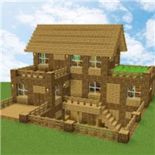

# Перенос миров Block Crazy на новое устройство

[English](README.md) | **Русский**

Миры можно снять только со старого устройства на **Android 11 или ниже** или с устройства, где уже стоит **пропатченная игра** ([PATCH.ru.md](PATCH.ru.md)). На новое устройство ставится пропатченная игра: тогда миры можно будет переносить и дальше.

## 1. Подходит ли вам эта инструкция



| | |
|---|---|
| Название на устройстве | **Block Crazy** |
| Идентификатор | `com.crazy.block.robo.monster.cliffs.craft` |
| Google Play | [ссылка](https://play.google.com/store/apps/details?id=com.crazy.block.robo.monster.cliffs.craft) (игру убрали из магазина) |

## 2. Что скачать

Скрипты **[backup.ps1](backup.ps1)** и **[restore.ps1](restore.ps1)**: откройте каждый и нажмите **Download raw file** (⬇). Положите оба в одну папку, например `C:\BlockCrazy`. ADB скрипты скачают сами.

## 3. Включить отладку по USB (на обоих устройствах)

**Обычный Android:** «Настройки → О планшете» (или «О телефоне») → 7 раз нажмите «Номер сборки». «Настройки → Система → Для разработчиков» → включите **Отладка по USB**.

**Xiaomi:** «Настройки → О планшете» (или «О телефоне») → 7 раз нажмите «Версия ОС». «Настройки → Дополнительные настройки → Для разработчиков» → включите **Отладка по USB** и **Установка через USB**.

Сообщения скриптов на английском. Когда в конце строки стоит `[Enter]`, сделайте то, что написано, и нажмите Enter. При подключении:
* `Tablet not found...`: подключите кабель и включите отладку;
* `On the tablet, tap "Allow USB debugging"`: на устройстве нажмите **«Разрешить»**;
* `More than one device is connected...`: оставьте подключённым одно устройство.

## 4. Старое устройство → backup.ps1

Подключите **старое** устройство. Откройте PowerShell и выполните:
```powershell
cd C:\BlockCrazy
powershell -ExecutionPolicy Bypass -File .\backup.ps1
```
* Оригинальная игра: на `tap "Back up my data"...` нажмите на устройстве «Создать резервную копию данных», пароль не вводите. Миры сохранятся в `blockcrazy.ab`.
* Пропатченная игра (`Patched game detected`): ничего нажимать не нужно. Миры сохранятся в `worlds.tar`.

Игра сохранится в папку `apk`. Если появилось `Worlds were NOT copied`, значит, на устройстве Android 12+ с оригинальной игрой, и миры с него не снять.

## 5. Пропатченная игра

Подготовьте пропатченные файлы по [PATCH.ru.md](PATCH.ru.md). Положите их в отдельную папку внутри `C:\BlockCrazy`, например `C:\BlockCrazy\patched`.

## 6. Новое устройство → restore.ps1

Подключите **новое** устройство. Оригинальной игры на нём быть не должно. Выполните:
```powershell
cd C:\BlockCrazy
powershell -ExecutionPolicy Bypass -File .\restore.ps1
```
1. `Several copies of the game were found`: введите номер папки `patched`.
2. `If the tablet asks, tap "Install"`: нажмите на устройстве «Установить».
3. `The tablet blocked the USB install` (бывает на Xiaomi): откройте на устройстве «Загрузки», нажмите на `base.apk`, установите и нажмите Enter.
4. `Done!`: миры перенесены.

⚠️ Миры, которые уже есть на новом устройстве, будут заменены.

## 7. Готово

Откройте игру и проверьте миры. Выключите «Отладку по USB» на обоих устройствах. Для резервной копии запускайте `backup.ps1` на новом устройстве.
